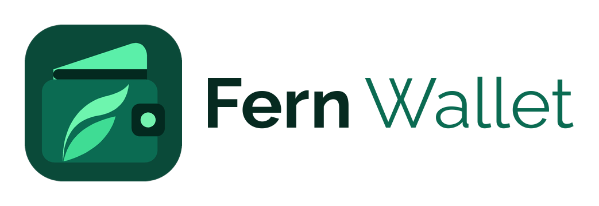
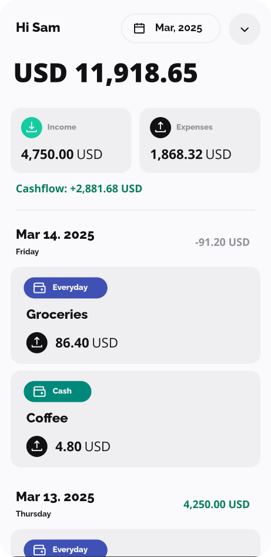
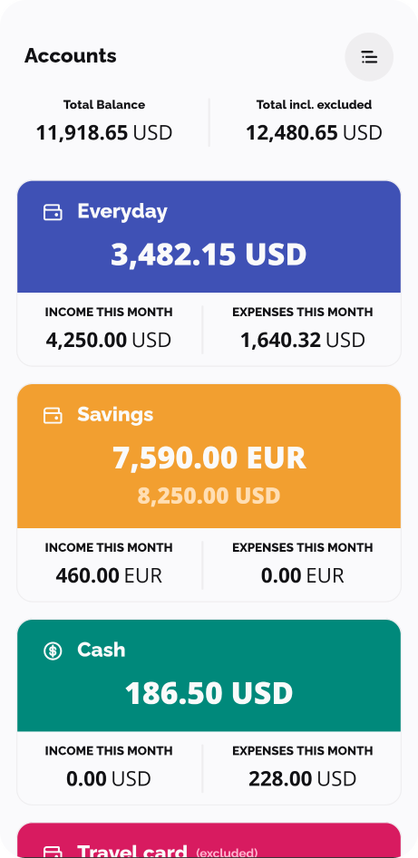
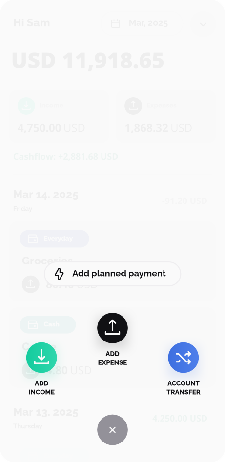
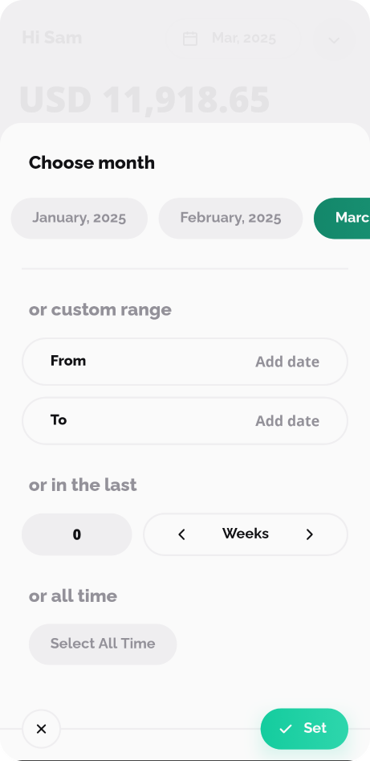
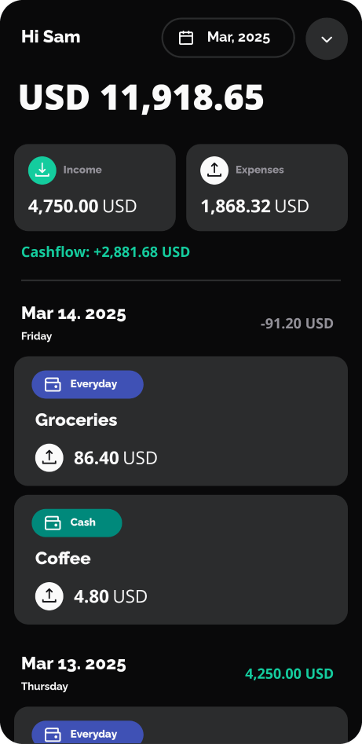
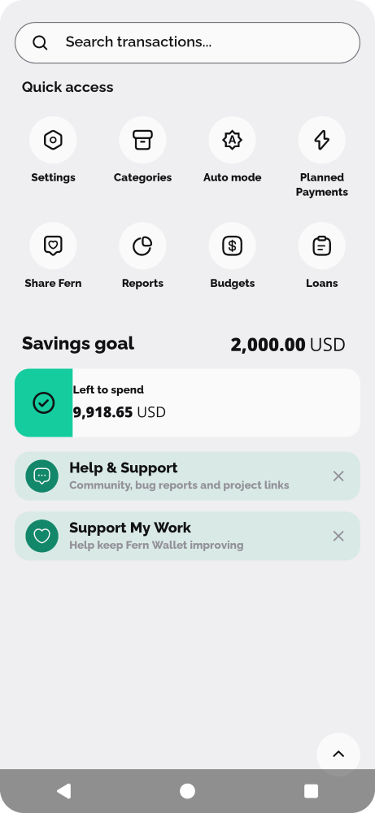
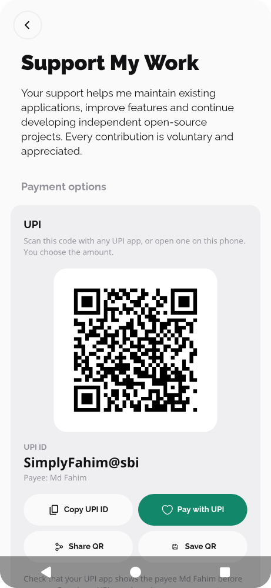

<div align="center">

<picture>
  <source media="(prefers-color-scheme: dark)" srcset="docs/branding/wordmark-dark.png">
  
</picture>

**A calm, open-source money manager for Android.**<br>
Accounts, budgets, credit cards and reports. No ads, no account, your data stays on your phone.

[](#-download)
[](LICENSE)
[](https://github.com/SimplyFahimOfficial/Fern-wallet/releases)
[](https://github.com/SimplyFahimOfficial/Fern-wallet/stargazers)
[](https://t.me/Fernwallet)

[Features](#-features) · [Download](#-download) · [Build](#-build-from-source) · [Credits](#-credits) · [Contact](#-contact) · [Support](#-support-the-project)

</div>

---

## ✨ Features

- 💼 **Accounts and transactions.** Multiple accounts with their own currency, color and icon. Income, expenses and transfers with categories, tags and notes.
- 📅 **Flexible periods.** Monthly overview with a custom month start day, custom ranges, "last N days/weeks/months" and all time.
- 💳 **Credit cards.** Limits and available credit, calculated statements and due dates, bill payments as transfers, due-date reminders and a catalogue of Indian banks and cards ([docs](docs/Credit-Cards.md)).
- 🎯 **Plan ahead.** One-time and recurring planned payments, budgets, loans and a savings goal.
- 📊 **Insights.** Reports, pie-chart statistics and search.
- 💱 **Multi-currency.** Exchange rates fetched over HTTPS from a public currency API, with manual overrides.
- 🔄 **Your data, portable.** Backup and restore to a ZIP file, plus CSV import from Ivy Wallet, Money Manager, Wallet by BudgetBakers, Spendee, Monefy, 1Money, BlueCoins, KTW Money Manager, Fortune City and Financisto.
- 🧩 **Quick access.** Home-screen widgets, app shortcuts and a Quick Settings tile.
- 🔒 **Privacy.** App lock with biometrics or device credential, hide balances, and no analytics or crash reporting.
- 🎨 **Appearance.** System, light, dark and AMOLED themes, color presets or your own colors for light and dark, and four app icons (Fern, Mono, Graphite, Midnight).

## 📸 Screenshots

<div align="center">
  
  
  
  
  <br><br>
  
  
  
  <br>
  <sub>Rendered from Compose previews with sample data (Paparazzi). Regenerate with <code>./gradlew recordPaparazziDebug && python3 scripts/readme_screenshots.py</code>.</sub>
</div>

## 📥 Download

Signed builds are published on [GitHub Releases](https://github.com/SimplyFahimOfficial/Fern-wallet/releases) with an APK, an AAB, an SBOM, `SHA256SUMS.txt` and a build-provenance attestation. No release has been published yet, so for now [build it from source](#-build-from-source). Fern Wallet needs Android 9.0 (API 28) or newer and is not on Google Play or F-Droid yet.

Verify a download:

```bash
sha256sum -c SHA256SUMS.txt --ignore-missing
gh attestation verify FernWallet-<version>.apk --repo SimplyFahimOfficial/Fern-wallet
```

> [!NOTE]
> **Coming from Ivy Wallet?** Fern Wallet uses its own app ID (`com.fernwallet.app`), so it installs next to Ivy Wallet and starts empty. Export with **Settings → Backup data** in Ivy Wallet, then use **Settings → Import data** in Fern Wallet. See [docs/Package-Identity.md](docs/Package-Identity.md).

## 🔨 Build from source

**Requirements:** JDK 21 (the build targets Java 17 bytecode) and Android SDK platform 37. The Gradle wrapper downloads Gradle 9.8.2.

```bash
git clone https://github.com/SimplyFahimOfficial/Fern-wallet.git
cd Fern-wallet

./gradlew :app:assembleDebug     # app/build/outputs/apk/debug/app-debug.apk
./gradlew testDebugUnitTest      # unit tests and Paparazzi rendering
./gradlew detekt lintRelease     # static analysis and Android lint
```

| Build type | App ID | Signing | Use |
|---|---|---|---|
| `debug` | `com.fernwallet.app.debug` | public debug key | development |
| `demo` | `com.fernwallet.app.demo` | public debug key | minified test build, never distribute |
| `release` | `com.fernwallet.app` | `SIGNING_*` environment variables | published builds |

Releases, CI and troubleshooting: [docs/RELEASE.md](docs/RELEASE.md), [docs/CI_CD.md](docs/CI_CD.md) and [docs/CI-Troubleshooting.md](docs/CI-Troubleshooting.md). Contributions are welcome; start with [CONTRIBUTING.md](CONTRIBUTING.md) and [docs/Guidelines.md](docs/Guidelines.md).

## 🧰 Tech stack

| Area | Technology |
|---|---|
| Language | Kotlin 2.4, Coroutines and Flow |
| UI | Jetpack Compose, Material 3, Glance widgets, a legacy in-house design system |
| Architecture | Multi-module (`feature/*`, `shared/*`, `widget/*`), Hilt, ArrowKt |
| Data | Room, DataStore, kotlinx.serialization |
| Networking | Ktor client (OkHttp engine) |
| Background | WorkManager |
| Testing | JUnit, Kotest, MockK, Paparazzi |
| Tooling | Gradle 9.8 with convention plugins, AGP 9.5, Detekt, ktlint, compose-lints |

## 🙏 Credits

Fern Wallet is a fork of [**Ivy Wallet**](https://github.com/Ivy-Apps/ivy-wallet) by Ivy Apps Ltd and the [Ivy Wallet contributors](https://github.com/Ivy-Apps/ivy-wallet/graphs/contributors), which is no longer maintained upstream. Most of the code is theirs. The original design system is by Stefan Ilijev. Kotlin sources keep the `com.ivy.*` packages so upstream fixes stay easy to apply. Third-party libraries, fonts and icons are listed in the app under **Settings → Attributions**.

## 📄 License

Fern Wallet is free software under the [GNU General Public License v3.0](LICENSE), without any warranty. Security issues: [SECURITY.md](SECURITY.md). Privacy: [PRIVACY.md](PRIVACY.md).

## 📬 Contact

<div align="center">

<a href="https://instagram.com/SimplyFahimofficial"></a>
<a href="mailto:SimplyFahim@tuta.io"></a>
<a href="mailto:simplyfahimofficial@gmail.com"></a>
<br>
<a href="https://SimplyFahim.pages.dev"></a>
<a href="https://github.com/SimplyFahimOfficial"></a>

</div>

---

<div align="center">

## 💚 Support the Project

<picture>
  <source media="(prefers-color-scheme: dark)" srcset="docs/assets/support/banner-dark.svg">
  
</picture>

Fern Wallet is free and ad-free. If it helps you keep your money in order, a small donation keeps development going.

<table>
<tr>
<td align="center" valign="top">

<a href="https://simplyfahim.pages.dev/pay/"></a>

### 👆 **Tap the QR to open UPI payment options**

**Payee:** Md Fahim<br>
**UPI ID**

```
SimplyFahim@sbi
```

<a href="https://simplyfahim.pages.dev/pay/"></a>

<sub>You choose the amount. Check that your UPI app shows <b>Md Fahim</b> before you pay.</sub>

</td>
</tr>
</table>

**[More ways to pay → simplyfahim.pages.dev/pay-options](https://simplyfahim.pages.dev/pay-options)**

### Community

<a href="https://t.me/Fernwallet"><picture><source media="(prefers-color-scheme: dark)" srcset="docs/assets/support/telegram-card-dark.svg"></picture></a>

**[Join the Fern Wallet group on Telegram → t.me/Fernwallet](https://t.me/Fernwallet)**

In the app, all of this is under **Settings → Help & Support**. Project page:
[simplyfahim.pages.dev/fernwallet](https://simplyfahim.pages.dev/fernwallet) ·
Contact the developer: [simplyfahim.pages.dev/contactme](https://simplyfahim.pages.dev/contactme)

</div>
