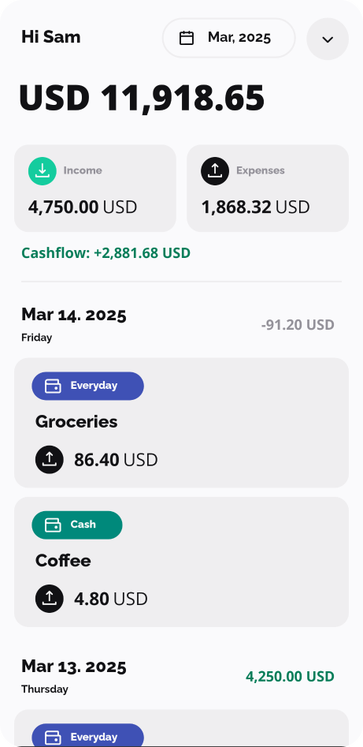
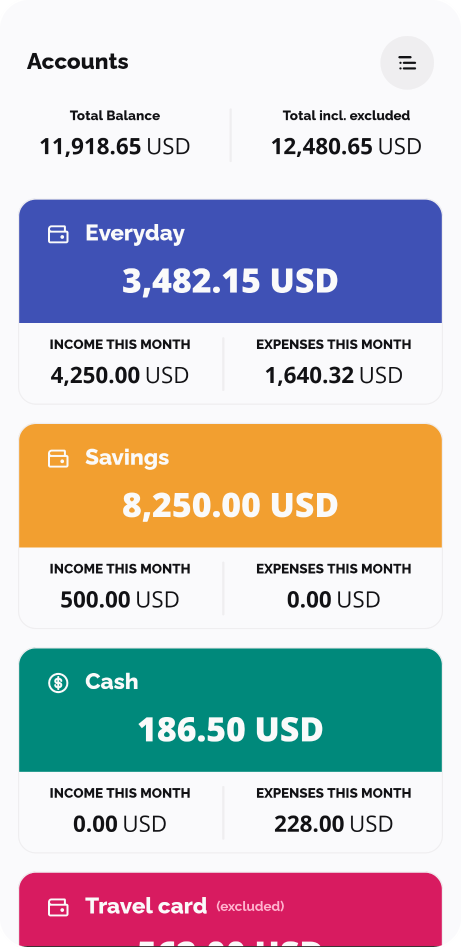
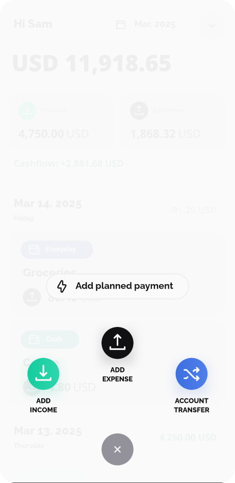
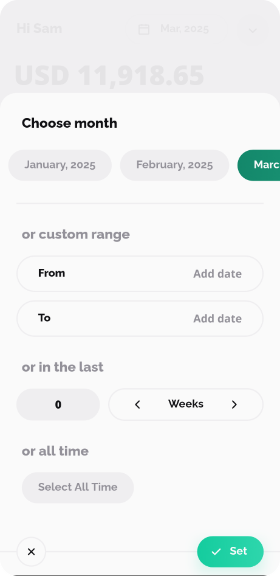
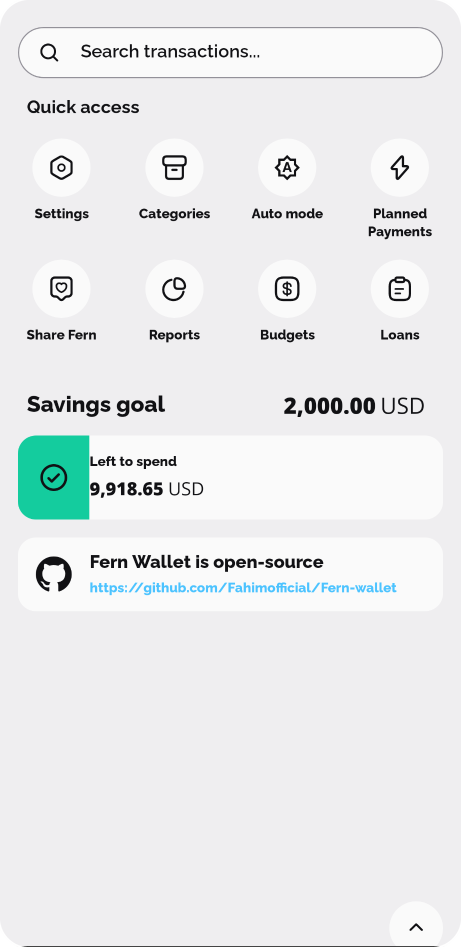
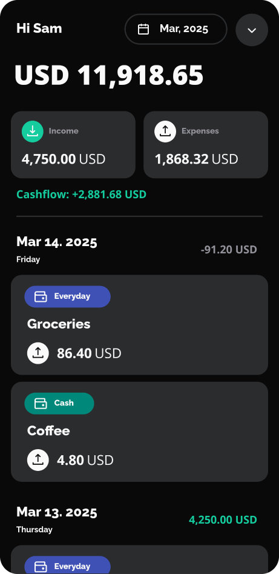
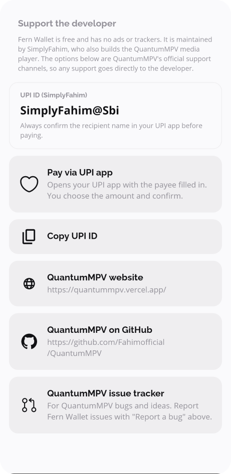

<p align="center">
  
</p>

<h1 align="center">Fern Wallet</h1>

<p align="center">
  A free, open-source money manager for Android: accounts, transactions, budgets, planned payments, loans and reports.
  <br/>No ads, no trackers, no account required. Your data stays on your device.
</p>

<p align="center">
  <a href="https://github.com/Fahimofficial/Fern-wallet/actions/workflows/ci.yml"></a>
  <a href="https://github.com/Fahimofficial/Fern-wallet/releases"></a>
  <a href="LICENSE"></a>
</p>

<p align="center">
  
  
  
  
</p>
<p align="center">
  
  
  
</p>

<sub>Rendered from the app's Compose previews with made-up sample data (Paparazzi), not from a real device or account.
Regenerate with `./gradlew recordPaparazziDebug && python3 scripts/readme_screenshots.py`.</sub>

## About

Fern Wallet is a fork of [Ivy Wallet](https://github.com/Ivy-Apps/ivy-wallet) by Ivy Apps and its
contributors, which is no longer maintained upstream. Fern Wallet continues development under the same
[GPL-3.0 license](LICENSE). Most of the code was written by the Ivy Wallet contributors; see
[Upstream & attribution](#upstream--attribution).

## Features

- Multiple accounts with their own currency, color and icon; total balance with optional excluded accounts
- Income, expense and account-transfer transactions with categories, tags and descriptions
- Monthly overview with a custom month start day, custom date ranges, "last N days/weeks/months" and all-time
- Planned (one-time and recurring) payments, budgets, loans, savings goal ("left to spend")
- Reports, pie-chart statistics, search
- Exchange rates (fetched over HTTPS from a public currency API) and manual overrides
- Backup/restore to a ZIP file, CSV import from several apps
- Home-screen widgets, app shortcuts and a Quick Settings tile
- App lock (biometric / device credential), hide balance/income
- Light, dark and AMOLED-black themes

## Download

Signed APKs and AABs are published on the [Releases page](https://github.com/Fahimofficial/Fern-wallet/releases),
each with a `SHA256SUMS.txt`. Verify a download with:

```sh
sha256sum -c SHA256SUMS.txt --ignore-missing
```

> **Coming from Ivy Wallet?** Fern Wallet has its own application ID (`com.fernwallet.app`), so it installs
> *next to* Ivy Wallet instead of updating it, and starts empty. To move your data: in Ivy Wallet open
> **Settings → Backup data**, then in Fern Wallet open **Settings → Import data** and pick the backup ZIP.
> See [docs/Package-Identity.md](docs/Package-Identity.md).

## Build from source

Requirements: JDK 17, Android SDK (compile SDK 34). The Gradle wrapper downloads Gradle 8.8.

```sh
git clone https://github.com/Fahimofficial/Fern-wallet.git
cd Fern-wallet
./gradlew :app:assembleDebug            # app/build/outputs/apk/debug/app-debug.apk
```

| Build type | Application ID | Signing | Purpose |
|---|---|---|---|
| `debug` | `com.fernwallet.app.debug` | public debug key (`debug.jks`) | development |
| `demo` | `com.fernwallet.app.demo` | public debug key | minified test build; **never distribute** |
| `release` | `com.fernwallet.app` | your key via env vars (below) | published builds |

Release builds read signing details only from the environment:

```sh
export SIGNING_STORE_FILE=/path/to/release.jks
export SIGNING_STORE_PASSWORD=... SIGNING_KEY_ALIAS=... SIGNING_KEY_PASSWORD=...
./gradlew :app:assembleRelease :app:bundleRelease
```

### Checks

```sh
./gradlew testDebugUnitTest      # unit tests (+ Paparazzi screenshot rendering)
./gradlew verifyPaparazziDebug   # compare screenshots with recorded golden images
./gradlew recordPaparazziDebug   # re-record golden images after intentional UI changes
./gradlew detekt                 # static analysis & formatting (ktlint rules)
./gradlew lintRelease            # Android lint
```

### Troubleshooting

- **`SDK location not found`** – create `local.properties` with `sdk.dir=/path/to/Android/sdk`, or set `ANDROID_HOME`.
- **Unsupported class file / JVM errors** – use JDK 17 (`java -version`).
- **Paparazzi failures** – check `**/build/paparazzi/failures`. If the UI change was intended, run `recordPaparazziDebug` and commit the images.
- **`./gradlew assembleRelease` fails in `:feature:*:verifyReleaseResources`** – a known upstream issue with library-only resource verification; build the app module instead: `./gradlew :app:assembleRelease`.

## Releasing

See [docs/Releasing.md](docs/Releasing.md). In short: run the **Prepare release** workflow, merge its PR,
push the tag `v<version-name>`; CI builds, signs, verifies and drafts the GitHub release for review.

## Contributing & support

- Bugs and feature requests: [Fern Wallet issues](https://github.com/Fahimofficial/Fern-wallet/issues)
- Contributing: [CONTRIBUTING.md](CONTRIBUTING.md) · Developer guidelines: [docs/Guidelines.md](docs/Guidelines.md)
- Security problems: see [SECURITY.md](SECURITY.md) (please don't open public issues)
- Privacy: [PRIVACY.md](PRIVACY.md)

**Supporting the developer.** Fern Wallet is maintained by Fahim (SimplyFahim), who also builds the
[QuantumMPV](https://github.com/Fahimofficial/QuantumMPV) media player. The in-app **Settings → Support the
developer** section links to QuantumMPV's official support channels
([website](https://quantummpv.vercel.app/), UPI ID `SimplyFahim@Sbi`). Support is always optional; always
confirm the recipient name in your UPI app before paying.

## Tech stack

Kotlin, Jetpack Compose (Material 3 + a legacy in-house design system), Coroutines/Flow, Hilt, ArrowKt,
Room, DataStore, Ktor client, kotlinx.serialization, WorkManager, Glance widgets. Tests: JUnit4, Kotest,
MockK, Paparazzi. Tooling: Gradle KTS with convention plugins and version catalogs, Detekt, ktlint,
Slack compose-lints, GitHub Actions.

## Upstream & attribution

Fern Wallet is based on **Ivy Wallet** © Ivy Apps Ltd and the
[Ivy Wallet contributors](https://github.com/Ivy-Apps/ivy-wallet/graphs/contributors), licensed under the
GNU GPL v3. The original design system was created by Stefan Ilijev. Kotlin sources keep the upstream
`com.ivy.*` package names to make upstream fixes easy to apply. Third-party libraries, fonts and icons are
listed in the app under **Settings → Attributions**.

Fern Wallet is distributed under the [GNU General Public License v3.0](LICENSE), without any warranty.
